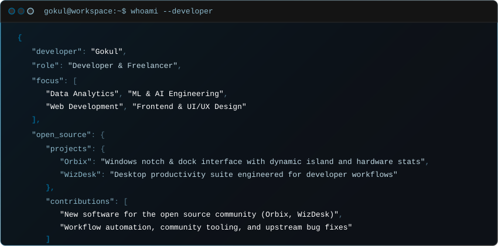

  
  

    
    
    
    
  

  

 

### Featured Open Source

| Project | Description | Scope |
| :--- | :--- | :--- |
| **Orbix** | Windows notch and dock interface featuring dynamic island status, hardware monitoring, calendar, stopwatch, application search, wallpaper carousel, and power menu controls. | Desktop Utility |
| **WizDesk** | Desktop utility suite engineered to streamline developer workflows, shortcut automation, and daily productivity tasks. | Developer Tooling |

 

### Skills & Technologies

<table>
  <tr>
    <td width="28%" valign="top"><b>Core & Data / ML</b></td>
    <td>
      
      
      
      
      
      
      
      
      
    </td>
  </tr>
  <tr>
    <td width="28%" valign="top"><b>Web & UI</b></td>
    <td>
      
      
      
      
      
      
      
    </td>
  </tr>
  <tr>
    <td width="28%" valign="top"><b>Tools & AI Environment</b></td>
    <td>
      
      
      
      
      
      
      
      
      
      
      
      
    </td>
  </tr>
</table>

 

  

